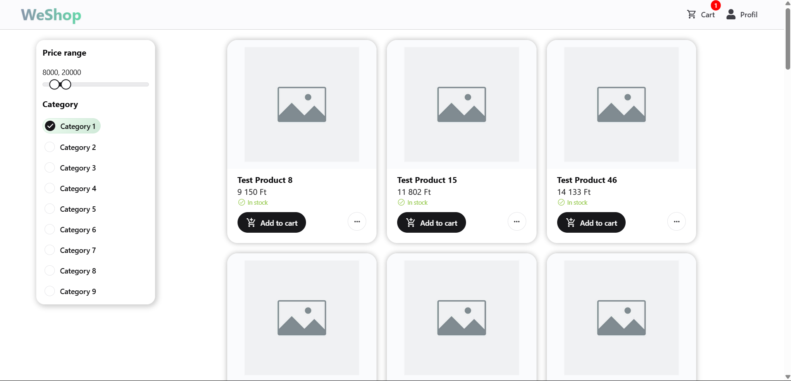

# WeShop

**WeShop** is a modern, collaborative web shopping platform where users can **share carts** in real-time and **shop together**. Built as a university semester project using modern technologies and a clean architecture approach.

 <!-- opcionális -->

## Features

- **Shared Carts** – Real-time cart collaboration using SignalR
- **Multi-step Checkout** – Seamless step-by-step purchase process
- **Glassy UI** – Apple-style modern, minimalistic design
- **JWT Authentication** – Secure user login and session handling
- **Filterable Product Lists** – Paginated views with live filters
- **SPA** – architecture with smooth animations and state management

## Tech Stack

### Frontend

- [React](https://reactjs.org/) + [TypeScript](https://www.typescriptlang.org/)
- [Vite](https://vitejs.dev/) for blazing-fast dev experience
- [TanStack Query](https://tanstack.com/query/v4) for data fetching & caching
- [Chakra UI](https://chakra-ui.com/) + custom theming
- [React Hook Form](https://react-hook-form.com/)
- [React Router](https://reactrouter.com/)
- [SignalR](https://learn.microsoft.com/en-us/aspnet/core/signalr/introduction) client

### Backend

- ASP.NET Core 9 Web API
- Entity Framework Core + Repository pattern
- JWT-based Authentication

## Setup Instructions

### Prerequisites

- Node.js v18+
- .NET 9 SDK
- SQL Server

### Running Locally

#### Frontend

```bash
cd frontend
npm install
npm run dev
```

#### Backend

```bash
cd backend
dotnet build
dotnet run
```
